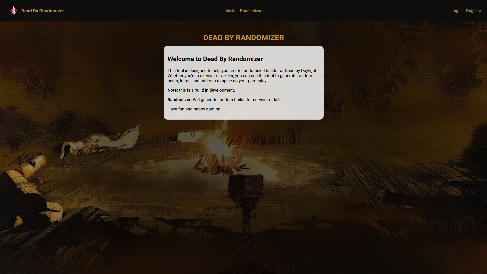

<div align="center">


<h1>DeadByRandomizer</h1>

<p>Gerador de builds aleatórias para <strong>Dead by Daylight</strong>.<br/>
Escolha entre Survivor ou Killer e receba uma build completa em um clique.</p>

<p>
  <a href="https://dead-by-randomizer.vercel.app"><strong>Acessar o site</strong></a>
  ·
  <a href="https://github.com/gabrielfernandesdelara/DeadByRandomizer/issues/new">Reportar um bug</a>
  ·
  <a href="https://github.com/gabrielfernandesdelara/DeadByRandomizer/issues/new">Sugerir uma funcionalidade</a>
</p>

<p>
  
  
</p>

</div>

---

<details>
  <summary><strong>Sumário</strong></summary>

- [Sobre o projeto](#sobre-o-projeto)
- [Funcionalidades](#funcionalidades)
- [Tecnologias](#tecnologias)
- [Como rodar localmente](#como-rodar-localmente)
- [Estrutura de pastas](#estrutura-de-pastas)
- [Roadmap](#roadmap)
- [Aviso legal](#aviso-legal)
- [Autor](#autor)

</details>

## Sobre o projeto

<div align="center">
  
  <br/>
  <sub><em>Página inicial. O layout pode sofrer alterações.</em></sub>
  <br/>
</div>

O **DeadByRandomizer** nasceu para resolver um problema comum de quem joga Dead by Daylight: cansar de usar sempre a mesma build. Você escolhe o lado (Survivor ou Killer) e o site sorteia uma build completa, com quatro perks diferentes e um item ou poder.

O projeto é uma aplicação web estática, sem frameworks, e todos os dados ficam em arquivos JSON organizados por categoria.

## Funcionalidades

- Sorteio de **4 perks sem repetição** para Survivor ou Killer
- Sorteio de **item** (Survivor) ou **poder** (Killer), com indicação de raridade
- Descrição de cada item e poder em tooltip
- Base com **136 perks de Killer**, **173 perks de Survivor**, **42 poderes** e **23 itens**
- Layout responsivo com menu hambúrguer no mobile

## Tecnologias

<p>
  
  
  
  
  
</p>

| Tecnologia | Uso |
|---|---|
| HTML5 | Estrutura das páginas |
| CSS3 | Estilização e responsividade |
| JavaScript | Lógica do sorteio e manipulação do DOM |
| JSON | Base de dados de perks, itens e poderes |
| Vercel | Hospedagem e deploy contínuo |

## Como rodar localmente

O site carrega os dados com `fetch`, então ele precisa rodar em um servidor local. Abrir o `index.html` direto no navegador não funciona.

```bash
# 1. Clone o repositório
git clone https://github.com/gabrielfernandesdelara/DeadByRandomizer.git

# 2. Entre na pasta
cd DeadByRandomizer

# 3. Suba um servidor local (precisa do Node.js)
npx serve .
```

Depois é só abrir o endereço que aparecer no terminal. Se preferir, a extensão **Live Server** do VS Code também funciona.

## Estrutura de pastas

```
DeadByRandomizer/
├── index.html                 # Página inicial
├── Randomizer.html            # Página do randomizer
├── css/
│   └── styles.css             # Estilos globais
├── scripts/
│   └── script.js              # Lógica do sorteio
└── assets/
    ├── data/
    │   ├── perks/
    │   │   ├── killer.json    # Perks de Killer
    │   │   └── survivor.json  # Perks de Survivor
    │   └── itemPower/
    │       ├── itens.json     # Itens de Survivor
    │       └── powers.json    # Poderes de Killer
    └── images/
        ├── background/        # Imagem de fundo
        ├── icons/             # Ícones da interface
        ├── itens/             # Imagens dos itens
        ├── perks/             # Imagens dos perks (killer e survivor)
        └── powers/            # Imagens dos poderes
```

## Roadmap

- [x] Sorteio de perks para Survivor e Killer
- [x] Sorteio de item ou poder com raridade
- [x] Layout responsivo
- [ ] Design reformulado
- [ ] API de perks atualizada automaticamente
- [ ] Sorteios de Personagens e demais coisas
- [ ] Página de builds salvas

## Aviso legal

Este é um projeto pessoal e **não possui afiliação** com a Behaviour Interactive ou com o jogo Dead by Daylight. Todos os direitos sobre o jogo, nomes e imagens pertencem aos seus respectivos donos.

## Autor

<p>
  Desenvolvido por <strong>Gabriel Fernandes de Lara</strong>
</p>

<p>
  <a href="https://www.linkedin.com/in/gabrielfernandesdelara/"></a>
  <a href="https://github.com/gabrielfernandesdelara"></a>
</p>
